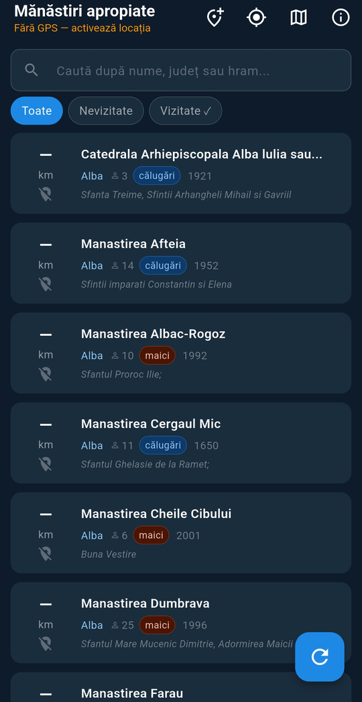

# ⛪ Monastery Finder (Mănăstiri Pelerini)

**An Android app for pilgrims: which Orthodox monasteries are near me, how far, in which direction, and which have I already visited?**
661 monasteries across Romania, sorted by distance from where you are, or from where you will be staying.

I built it for our own pilgrimages and use it on my phone.

<p align="center"></p>

**Tech:** Flutter / Dart · flutter_map (OpenStreetMap) · geolocator · SharedPreferences · Google Maps intents

---

## ✨ Features

- **Nearest first:** the list is sorted by distance from your GPS position (Haversine) and shows the **direction** (bearing from north) of each monastery.
- **Plan ahead from a saved place:** save locations such as a hotel or a relative's house (name + coordinates, pasted in any common format) and see the monasteries around *that* place instead of your current position.
- **Search** by name, county or dedication (hram), and filter **all / not visited / visited**.
- **Filter by community size:** a minimum number of monks or nuns, to skip abandoned hermitages or find the large monasteries.
- **Map:** all monasteries on an OpenStreetMap map, respecting the same filter.
- **Details:** dedication (hram), founding year, region, archdiocese and metropolis, number of monks or nuns, coordinates (copy with one tap).
- **Navigate:** opens Google Maps with directions, from your position or from the saved place.
- **Pilgrimage journal:** mark a monastery as visited and write your own notes; everything stays on the phone.
- Loads more results on demand, so the list stays fast.

## 📊 The data

`assets/manastiri.json`: 661 monasteries (657 with GPS coordinates) with county, type (monks / nuns), dedication, founding year, number of inhabitants, region, archdiocese, metropolis and coordinates.
It was built from a spreadsheet with `tools/convert_manastiri.py`, which also normalises county names and diacritics. The original spreadsheet is not included.

## 🏗️ Structure

```
lib/
  main.dart
  models/manastire.dart          the data model
  services/date_service.dart     loading, Haversine distance, bearing, sorting
  services/locatie_service.dart  GPS
  services/jurnal_service.dart   visited + personal notes (local storage)
  screens/ecran_lista.dart       list, filters, saved places
  screens/ecran_harta.dart       map
  screens/ecran_detalii.dart     details, navigation, journal
  widgets/card_manastire.dart
```

## 🚀 Build

```bash
flutter pub get
flutter run                      # on a connected phone
flutter build apk --release      # or build.bat, which also numbers the builds
```

The interface is in Romanian.

---

## 👤 Author

Mihai Mereu · [GitHub](https://github.com/mmereu97)
